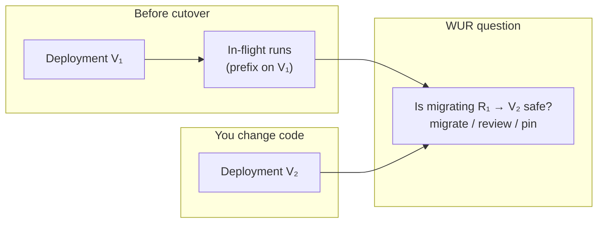
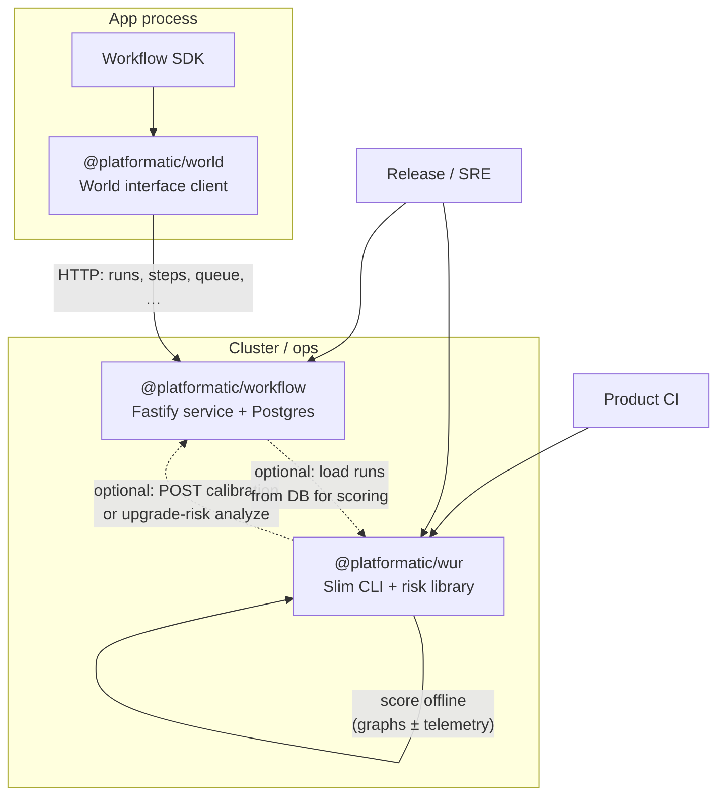
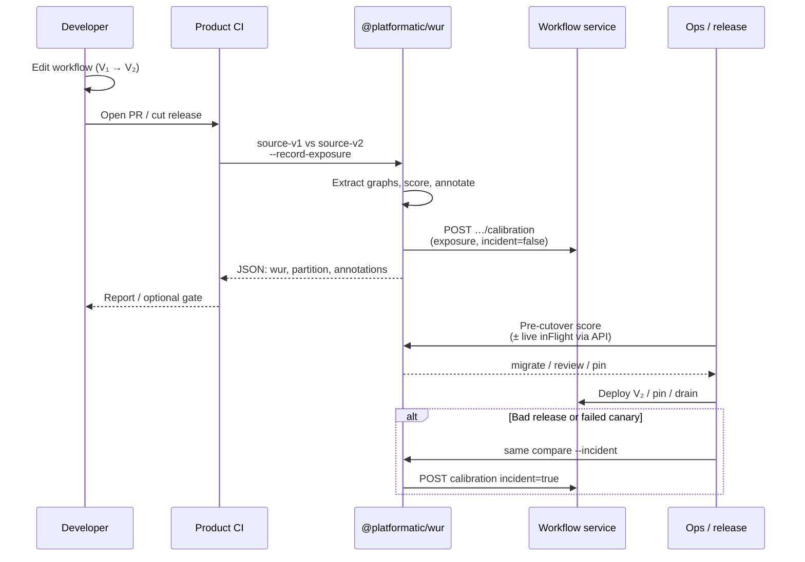
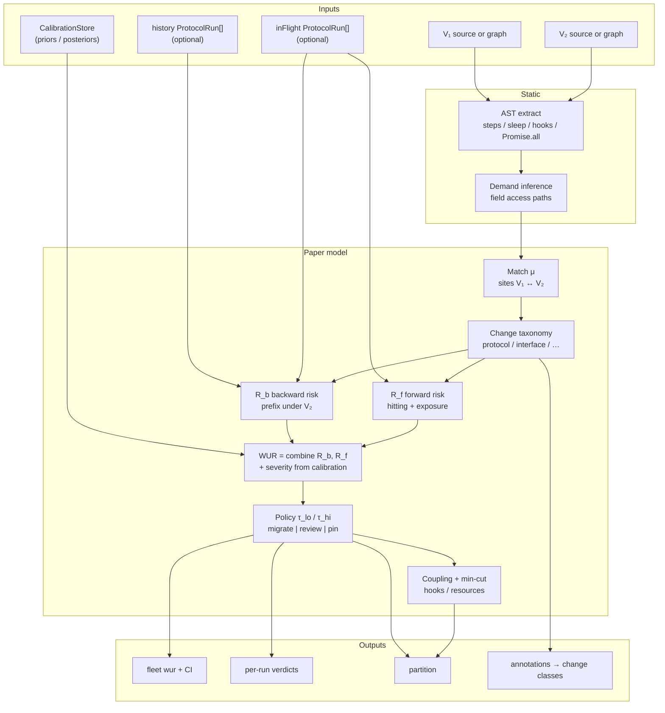
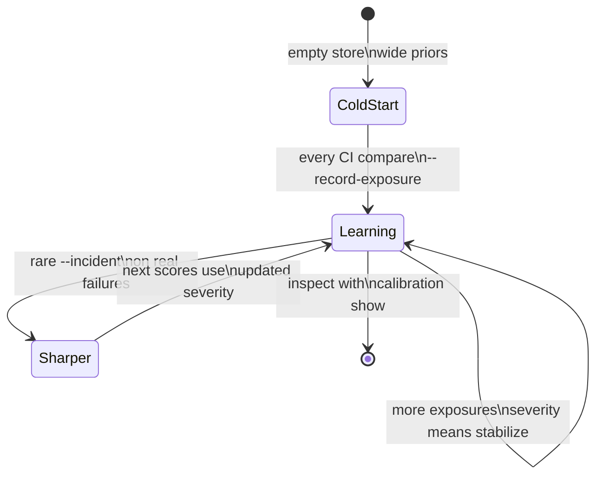
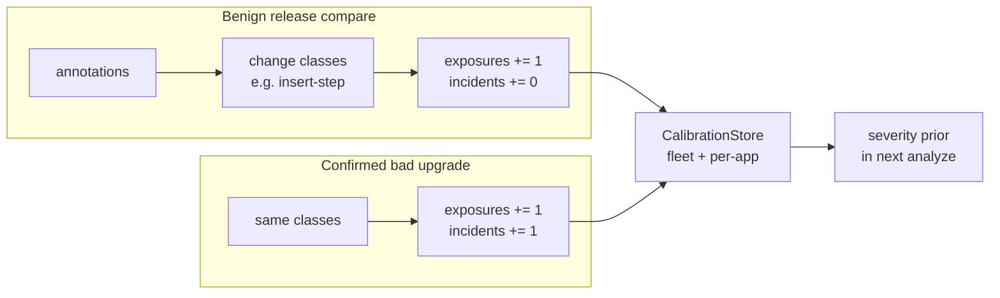
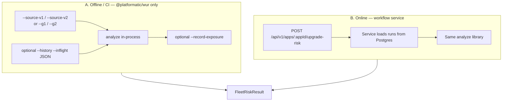
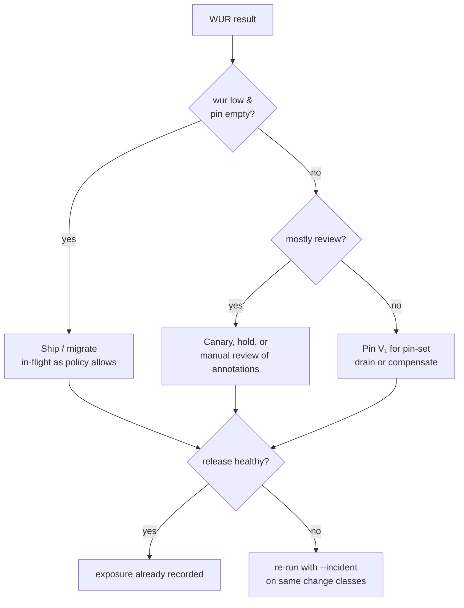
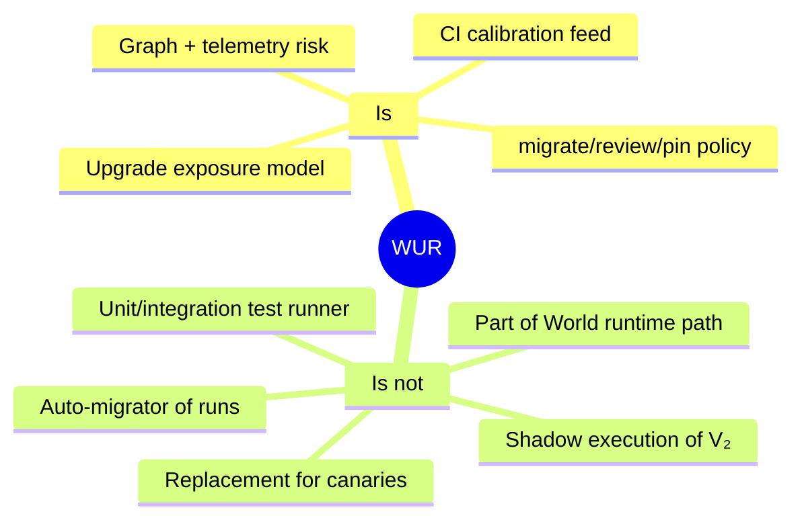

# Workflow Upgrade Risk — Operator & Developer Guide

**Package:** [`@platformatic/wur`](./README.md) · **Paper:** [arXiv:2607.13617](https://arxiv.org/abs/2607.13617) · **Model map:** [`lib/README.md`](./lib/README.md)

This guide is the practical companion to the paper: who uses WUR, how the pieces fit, and what “good” looks like in CI and production. Diagrams use Mermaid (rendered on GitHub).

---

## 1. The problem

Durable workflows outlive deploys. When you ship **V₂**, runs started on **V₁** may still be mid-graph. A dry-run of V₂ does not answer:

> For each in-flight run, how likely is the completed prefix (and the remaining path) to break under V₂?

WUR scores that **without sandbox execution**: it uses step graphs, optional telemetry, and a learned severity prior per *change class*.



**Outputs you care about**

| Output | Meaning |
|--------|---------|
| **WUR** (fleet / per-run) | Combined backward + forward risk (higher = worse) |
| **partition.migrate** | Safe enough to move with V₂ |
| **partition.review** | Human / canary / wait |
| **partition.pin** | Keep on V₁ until drain |
| **annotations** | Structural deltas (insert-step, delete-site, …) |
| **calibration** | Optional: recorded exposures/incidents for learning |

---

## 2. Where `@platformatic/wur` sits

Three packages, three jobs. **WUR is not World.**



| Package | Install in app? | Install in CI? | Role |
|---------|-----------------|----------------|------|
| `@platformatic/world` | Yes (runtime) | No | Talk to the service as a World |
| `@platformatic/workflow` | No (deploy image) | No* | Own state, queue, versions |
| **`@platformatic/wur`** | Optional | **Yes** | Score upgrades; feed calibration |

\*App CI should **not** install the full workflow package just to run WUR.

---

## 3. Roles and expected flow



### Developer

1. Change workflow source.
2. Locally: `npx @platformatic/wur --source-v1 old.ts --source-v2 new.ts --json`.
3. Read **annotations** (what changed) and **partition** (if you have telemetry).

### CI

1. Install only `@platformatic/wur`.
2. Diff base…head (or fixed old/new artifacts).
3. Always **`--record-exposure`** on release compares when a service URL is available.
4. **Never** default `--incident` on every PR.
5. Optional hard gate: fail if `partition.pin` non-empty or `wur > τ` once you trust calibration.

### Ops

1. Before cutover: score with real in-flight data when possible (`POST …/upgrade-risk` on the service, or CLI with `--history` / `--inflight` JSON).
2. Act on **migrate / review / pin**.
3. After a confirmed bad upgrade class: re-run with **`--incident`** against the **production** service (not ephemeral CI Postgres).

---

## 4. Scoring pipeline (functional)

What happens inside one analyze call:



**Intuition**

- **R_b**: “Does what already completed still make sense on V₂?”
- **R_f**: “How exposed is the unfinished work under the new graph?”
- **Calibration**: “When we saw this *kind* of change before, how often did it hurt?”

Without telemetry, you still get structural signal (annotations + source-only risk). With telemetry (service DB or JSON files), partitions become fleet-aware.

---

## 5. Calibration feedback loop





**Where data is stored**

| Mode | How | When to use |
|------|-----|-------------|
| **HTTP** `--service-url` | `POST /api/v1/apps/:appId/upgrade-risk/calibration` | **Product CI / ops** (recommended) |
| **Postgres** `DATABASE_URL` | table `workflow_wur_calibration` (needs optional peer `pg`) | Monorepo CI, local service DB |
| **Memory** | process only | Dry runs; prints a warning |

Keys: per-app (`app-id`) + fleet prior for cold starts.

---

## 6. Two ways to get a score



| Path | Pros | Cons |
|------|------|------|
| **A Slim CLI** | No Fastify install; perfect for PR CI | Needs you to supply graphs/sources; live runs only if you export JSON |
| **B Service API** | Uses real in-flight telemetry automatically | Needs running `@platformatic/workflow` |

Hybrid (common): **CI uses A** for every PR; **ops uses B** (or A + exported telemetry) at cutover.

---

## 7. CLI map

```text
npx @platformatic/wur [command] [flags]

  (default) analyze
      --source-v1 / --source-v2     extract + score
      --g1 / --g2                   prebuilt graph JSON
      --history / --inflight        ProtocolRun[] JSON
      --workflow <name>             which export when multi-workflow
      --tau-lo / --tau-hi           partition thresholds
      --json                        machine-readable result
      --record-exposure             write change-class exposure
      --incident                    mark exposure as bad outcome
      --app-id                      tenant key (or PLT_WORLD_APP_ID)
      --service-url                 HTTP calibration (or PLT_WORLD_SERVICE_URL)
      --database-url                direct PG (or DATABASE_URL; needs pg)

  --extract <file> [--workflow] [--out]
      emit graph manifest(s) only

  calibration record --app-id … --class insert-step[,…] [--incident]
  calibration show --app-id …
```

**Monorepo multi-file helper** (this repo only):

```bash
pnpm --filter @platformatic/wur run ci:compare
# env: WUR_BASE_SHA, WUR_HEAD_SHA, WUR_PATHS, WUR_RECORD, WUR_SERVICE_URL, …
```

---

## 8. Product CI recipe (minimal)

```yaml
# .github/workflows/wur.yml — illustrative
name: wur
on: pull_request
jobs:
  compare:
    runs-on: ubuntu-latest
    steps:
      - uses: actions/checkout@v4
        with: { fetch-depth: 0 }
      - uses: actions/setup-node@v4
        with: { node-version: 24 }
      - run: npm i -D @platformatic/wur
      - name: Score changed workflows
        env:
          PLT_WORLD_SERVICE_URL: ${{ secrets.WORKFLOW_SERVICE_URL }}
          PLT_WORLD_APP_ID: my-app
        run: |
          # Example single pair; or script a git-diff loop like scripts/wur-ci-compare.ts
          npx wur --source-v1 path/to/base.ts --source-v2 path/to/head.ts \
            --app-id "$PLT_WORLD_APP_ID" \
            --record-exposure \
            --service-url "$PLT_WORLD_SERVICE_URL" \
            --json
```

**Do**

- Use a **staging or prod-readable** service URL for durable calibration.
- Record exposure on merge/release paths so the prior learns.

**Don’t**

- Install `@platformatic/workflow` only to get the CLI.
- Pass `--incident` on green PRs.
- Rely on CI’s ephemeral Postgres as the long-term learning store.

---

## 9. Decision playbook



Interpret annotations first: an **insert-step at head** on non-empty prefixes is a different story than a **body-only** edit.

---

## 10. Library usage (same brain as CLI)

```ts
import {
  analyzeUpgradeRisk,
  extractWorkflowGraph,
} from '@platformatic/wur'

const g1 = extractWorkflowGraph(oldSource, 'orderFlow')!
const g2 = extractWorkflowGraph(newSource, 'orderFlow')!

const result = analyzeUpgradeRisk({
  g1,
  g2,
  history: [],      // completed runs if you have them
  inFlight: [],     // running runs if you have them
  options: {
    tauLo: 0.1,
    tauHi: 0.5,
    exactRegime: true,
    autoCouple: true,
  },
})

console.log(result.wur, result.partition, result.annotations)
```

Service plugin (`@platformatic/workflow`) imports this same library for HTTP endpoints.

---

## 11. What WUR is not



Correctness of new business logic still needs tests. WUR ranks **upgrade exposure** of durable prefixes under structural/interface change.

---

## 12. Package layout (this repo)

```text
packages/wur/
  cli.js                 # bin: wur / platformatic-wur
  README.md              # quick start
  GUIDE.md               # this document
  lib/                   # paper model + CLI implementation
    README.md            # module ↔ paper map
    analyze.ts           # Algorithm 1
    cli-wur.ts
    calibration*.ts
    static/              # AST extract, demand
    …
  scripts/
    wur-ci-compare.ts    # multi-file base…head helper
  test/                  # unit + corpus fidelity
```

Service integration (HTTP + DB): `packages/workflow/plugins/wur.ts` and `packages/workflow/test/wur-*.test.ts`.

---

## 13. Further reading

| Doc | Content |
|-----|---------|
| [`README.md`](./README.md) | Install, one-liners |
| [`lib/README.md`](./lib/README.md) | Paper module map, API list, limitations §11 |
| arXiv:2607.13617 | Definitions, equations, evaluation design |

Questions that usually mean “read the paper map”: *What is ≡_I? What is demand lattice unk?* → `lib/README.md` + modules named there.
